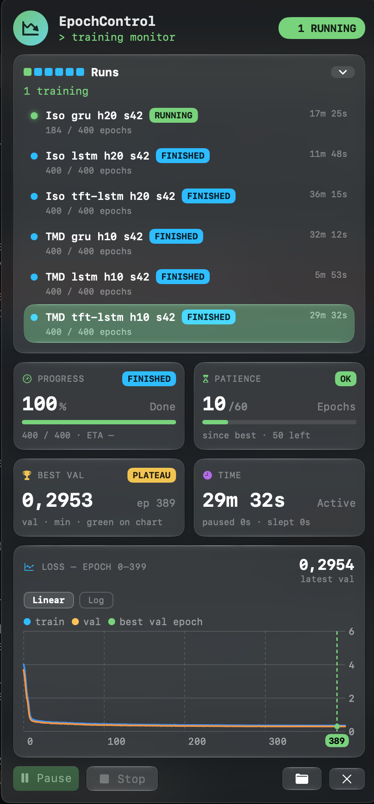

# EpochControl

See and control your training runs from the Mac menu bar.

A Python package plus a native macOS app: progress, losses and honest timing at a glance, with pause, resume and stop for a running job. Local, no account. Not an experiment tracker; it sits next to W&B, TensorBoard or trackio.

<p align="center"></p>

## Why

Long runs on a laptop raise the same questions every evening: how far is it, is it still learning, how long until it finishes, and can I pause it so the Mac can do something else? EpochControl answers them from the menu bar, without opening a terminal or a dashboard.

- **Progress and ETA** per run, with epochs done out of total.
- **Losses** as a small chart, best validation epoch marked, linear or log scale.
- **Patience**: epochs since the best value, and optional early stopping.
- **Honest timing**: active, paused and *slept* time are kept apart, so closing the lid does not inflate "training took 3 hours".
- **Pause, resume, stop** between epochs, with a checkpoint saved first if your script registers one.
- **CLI with `--json`**, so scripts and coding agents can read and control runs too.

## Install

```bash
pip install epochcontrol        # Python 3.10+, no required dependencies
```

The Mac app (macOS 14+) is built from [the repo](https://github.com/catalystdream/epochcontrol) for now:

```bash
cd macos && scripts/bundle.sh   # builds build/EpochControl.app (ad-hoc signed)
cp -R build/EpochControl.app /Applications/
```

The app opens by itself when a run starts. The package works without it (CLI only), on macOS and Linux.

## Use

Smallest change: wrap the epoch loop.

```python
import epochcontrol

for epoch in epochcontrol.loop(range(200), name="tft lstm h20"):
    train_one_epoch()
```

With losses, patience and a safe stop:

```python
import epochcontrol

run = epochcontrol.start(name="tft lstm h20", total_epochs=400, patience=60, monitor="val", mode="min")
run.on_checkpoint(lambda: save_checkpoint(ckpt_path))        # your existing save function
start_epoch = run.resume_from(ckpt_path, load_checkpoint)     # returns the epoch to start from
for epoch in run.epochs(start=start_epoch):
    train_loss = train_one_epoch()
    val_loss = validate()
    run.log(epoch=epoch, train=train_loss, val=val_loss)
run.finish()
```

Add `stop_on_patience=True` to `start()` to end the run after `patience` epochs without improvement. `with epochcontrol.start(...) as run:` also works; an exception then marks the run failed.

Runs started by one script can be shown together: put `export EPOCHCONTROL_GROUP="sweep A1" EPOCHCONTROL_GROUP_TOTAL=9` at the top of a bash loop (or pass `group=` and `group_total=` to `start()`), and the menu bar shows "sweep A1 · 4 of 9 done · 1 running · 4 to go".

## Command line

```bash
epochcontrol ls                 # all runs, newest first
epochcontrol status [RUN]       # one run in detail
epochcontrol pause  [RUN]       # acts at the end of the current epoch
epochcontrol resume [RUN]
epochcontrol stop   [RUN]
epochcontrol agent-guide        # instructions for coding agents
```

`RUN` is a run id, an id prefix or a name; without it, the only run in progress. Every command takes `--json`.

## How it works

The package writes a small folder per run (`~/Library/Application Support/EpochControl/runs/`, or `$EPOCHCONTROL_HOME/runs`): status, metrics and events as JSON, written atomically. The app and the CLI read those files and drop command files that the training loop picks up between epochs. Nothing connects to anything, so **training never depends on the app**: quit it, crash it, and the run carries on. A failure inside the package warns once and never raises into your loop.

The file format is defined in [`schemas/`](https://github.com/catalystdream/epochcontrol/tree/main/schemas).

## For coding agents

`epochcontrol agent-guide` and [`docs/llms.txt`](https://github.com/catalystdream/epochcontrol/blob/main/docs/llms.txt) tell an agent how to add EpochControl to a training script and how to read or control runs. Agents should never pause or stop a run without the user's approval.

## Status

Early. v0.1 (Python package and CLI) and v0.2 (the menu-bar app) work on real runs; next are notifications, settings, a run queue, framework adapters (Lightning, Keras, Hugging Face) and runs on other machines over SSH. Plan: [PRD.md](https://github.com/catalystdream/epochcontrol/blob/main/PRD.md).

## License

MIT
